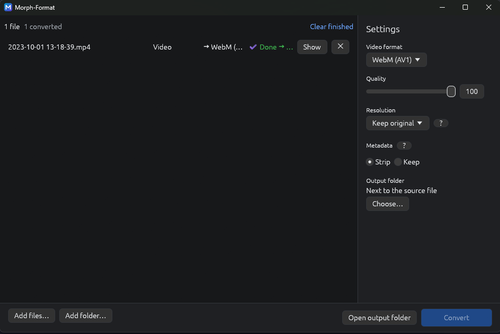

# Morph-Format

Convert photos and videos to other formats on your own computer. Nothing is uploaded: your files never leave your PC.

- Turn iPhone photos (HEIC) into JPEG, or PNG into WebP.
- Turn phone videos (MOV, MP4) into MP4, WebM or an animated GIF.
- Shrink videos to 1080p, 720p and so on, to send or share them more easily.
- Convert a whole folder at once.

Free and open source.

## Download and install (Windows)

1. Open the [Releases page](https://github.com/ArtArthur233/MorphFormat/releases) and download **`Morph-Format-<version>-windows-x64-setup.exe`**.
2. Run it. No administrator rights are needed.
3. Start **Morph-Format** from the Start menu.

**Windows shows "Windows protected your PC"?** This is normal: the installer is not signed with a paid certificate. Click **More info**, then **Run anyway**.

**To uninstall:** Windows **Settings → Apps → Installed apps → Morph-Format → Uninstall**.

macOS and Linux: no download yet. See [Build from source](#build-from-source).

## How to use it



1. **Add your files:** drag photos, videos or whole folders into the window, or click **Add files…** / **Add folder…**.
2. **Choose the settings** in the right-hand panel:
   - **Image format / Video format:** the format to convert to. Each list appears only when your queue holds that kind of file.
   - **Quality:** higher means better quality and a bigger file. It is greyed out for formats that don't use it (PNG, BMP, GIF, MKV).
   - **Resolution:** **Keep original** (the default), or 4K, 1440p, 1080p, 720p, 480p, 360p. Files that are already smaller are never enlarged.
   - **Metadata:** **Strip** (the default) removes hidden photo information such as the date, the camera and the GPS location. **Keep** copies it.
   - **Output folder:** next to each original file (the default), or a folder you choose.

   Hover over or click a **?** to get an explanation.
3. **Click Convert.** A progress bar shows where you are, and you can cancel at any time.
4. **Find your files:** click **Show** next to a converted file, or **Open output folder**.

Your originals are never modified or overwritten. If a file with the same name already exists, the new one gets a number, for example `photo (1).jpg`.

**Shortcuts:** `Ctrl+O` adds files, `Ctrl+Enter` converts, `Esc` cancels.

## Supported formats

| | You can open | You can create |
|---|---|---|
| **Photos** | JPEG, PNG, WebP, GIF, BMP, HEIC/HEIF (iPhone) | JPEG, PNG, WebP, GIF, BMP |
| **Videos** | MP4, MOV, M4V, MKV, WebM, AVI | MP4 (H.264), WebM (VP9 or AV1), MKV, animated GIF |

Good to know:
- **MP4** uses the video encoder built into Windows. If your system has none, MP4 is hidden and the app tells you why.
- **MKV** copies the video without re-encoding it: it is very fast and loses no quality.
- **Animated GIF** files are limited to 480 pixels wide unless you choose a resolution, because GIFs quickly become very large.

## Privacy

Everything happens on your computer. Morph-Format makes no internet connection, collects no statistics and writes nothing except your converted files.

## License

Morph-Format is free and open source, under your choice of the [MIT](LICENSE-MIT) or [Apache-2.0](LICENSE-APACHE) licence.

It is provided as is, **without warranty of any kind**: the authors are not liable for any damage, including damaged or lost files. Keep your originals until you have checked the results.

Morph-Format uses FFmpeg and libheif (LGPL licence), shipped as separate, replaceable files. Details: [THIRD-PARTY-NOTICES.md](THIRD-PARTY-NOTICES.md) and [docs/licences.md](docs/licences.md).

## Build from source

For developers. You need [Rust](https://www.rust-lang.org/tools/install) (stable).

```sh
cargo run -p morph-app                           # images only, pure Rust
cargo run -p morph-app --features heic,video     # adds HEIC and video (needs FFmpeg and libheif)
```

Native libraries: [Building FFmpeg](docs/build-ffmpeg.md) and [Building libheif](docs/build-libheif.md). Windows installer: [Packaging](docs/packaging.md).
